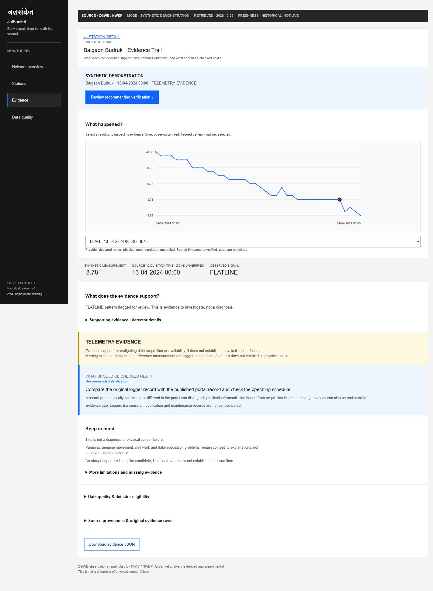
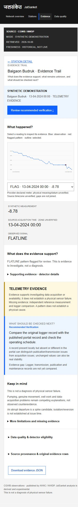

# JalSanket

Release freeze (October 11): dedicated Network → Station → Evidence routes; SPIKE on official data; FLATLINE/DROPOUT implementations with explicit metadata gates; four-state triage policy and NextCheck. FLATLINE/DROPOUT remain UNAVAILABLE on the current official snapshot. Controlled Q2 synthetic-pattern evaluation is recorded; no AWS cloud deployment is claimed.

Start both frontend and API from a terminal you keep open: `./scripts/start-local.ps1` (http://127.0.0.1:8766/). The static frontend uses the same FastAPI server; no second Node server is required. See [current verification](docs/VERIFICATION.md) and [AWS owner setup and deployment sequence](docs/AWS-ACCESS.md).

**Evidence-first groundwater telemetry triage.** Sensor problem, water problem, or insufficient evidence?

A working local first slice for Environmental Hacks, October 8–11, 2026. It preserves official provider measurements, screens eligible same-station sequences, exposes evidence gaps, abstains from unsupported causes and suggests a next discriminating check.

**This is not a diagnosis of physical sensor failure.** No AWS deployment or real sensor-failure accuracy is claimed.

## Screenshots from the working local app

Captured October 11 from real local API responses. **SYNTHETIC DEMONSTRATION:** these images show a controlled FLATLINE injection, not an actual CGWB incident, live feed or deployed AWS application.



<details>
<summary>Mobile Evidence Trail (390px viewport)</summary>



</details>

## 90-second demo startup

With dependencies and the pinned source CSV available, keep these **two PowerShell terminals** open from the repository root:

```powershell
# Terminal 1: official historical frontend + API
.\scripts\start-local.ps1 -Port 8768
```

```powershell
# Terminal 2: separately labelled synthetic FLATLINE frontend + API
.\.venv\Scripts\python.exe -m uvicorn scripts.synthetic_demo_app:app --host 127.0.0.1 --port 8770
```

Open http://127.0.0.1:8768/ and click **Start 90-second synthetic demo**. Select **Inspect FLATLINE pattern → Inspect Selected Evidence**, review uncertainty and **Recommended Verification**, then export JSON. First-time acquisition instructions are below; do not reacquire during a prepared recording unless the source is missing.

[Submission summary](docs/SUBMISSION-README.md) · [Video storyboard](docs/VIDEO-STORYBOARD.md) · [Owner checklist](docs/FINAL-CHECKLIST.md)

## Current status

| Status | Capability |
|---|---|
| IMPLEMENTED | Full official CSV acquisition and SHA-256 custody; five bounded station groupings; Pydantic contracts; quality/eligibility; deterministic evidence and next check; FastAPI; three-screen Network → Station → Evidence workflow |
| EXPERIMENTAL | One causal abrupt-departure/spike-candidate detector; uncalibrated 28-reading window, 20-reading minimum, six-scaled-MAD departure and step cutoffs |
| PARTIAL | Cloud deployment and real sensor-failure validation remain unavailable |
| SYNTHETIC | Reproducible controlled anomaly injections on Q2 official historical sequences; separate labelled demonstration app |
| ROADMAP | Submission demo and, only with separate authorization, cloud deployment |

No forecasting, chatbot, map or Bedrock. SPIKE, FLATLINE and DROPOUT are implemented; flatline/dropout explicitly report UNAVAILABLE / NOT_RUN on the official snapshot because required metadata is unverified. All five current assessments are UNCERTAIN; absence of a flag is not environmental evidence.

## Run locally

Requires Python 3.12+; Node/npm only for browser checks. From this repository:

```powershell
python -m venv .venv
.\.venv\Scripts\python.exe -m pip install -r requirements.lock
.\.venv\Scripts\python.exe scripts/acquire.py
.\.venv\Scripts\python.exe -m uvicorn backend.api:app --host 127.0.0.1 --port 8765
```

Open http://127.0.0.1:8765. Select a station, read the evidence preview, assessment and next check; expand quality and source rows. Raw data is downloaded locally and excluded from Git. Acquisition requires public NWDP access and fails on partial HTTP responses, length mismatch or an oversized resource. Reacquisition updates the manifest; compare the recorded hash if the provider revises its export.

If pip has a local environment issue, the verified alternative here was `uv pip install --cache-dir .cache/uv --python .venv/Scripts/python.exe -r requirements.lock`.

```powershell
.\.venv\Scripts\python.exe -m pytest -q
npm ci
npm run check
# With the API running and Google Chrome installed:
npm run test:e2e
```

The standalone Playwright launch was blocked by this session's Windows subprocess permissions. The script is provided for an unrestricted development terminal; it has **not passed here**. The supported in-app browser separately verified the actual network → evidence → abstention → next-check interaction, source rows, filtering and narrow layout. See [verification](docs/VERIFICATION.md).

## Actual architecture

```text
Official CGWB/NWDP CSV
  → operator acquisition script → local raw CSV + manifest
  → checksum-validated provider → Pydantic observations
  → scoped quality → per-observation eligibility → SPIKE / FLATLINE / DROPOUT (metadata-gated)
  → deterministic EvidencePackage → FastAPI → static HTML/CSS/JS
```

Data and evidence are loaded once at API startup; requests serve the pinned in-memory result. Restart after acquisition or backend changes. This is a local prototype with five groups and a fixed window, not a live ingestion service.

Read routes: `/api/health`, `/api/network`, `/api/stations/{station_group_key}`, `/api/stations/{station_group_key}/evidence`, `/api/stations/{station_group_key}/observations/{observation_id}/evidence`. Unknown IDs return 404; unsupported query parameters 422; missing/corrupt data 503. Pydantic schemas are exposed at `/docs`. There are no public writes, provider URL inputs, upload endpoints or credentials in the browser. Same-origin frontend/API requires no permissive CORS.

**AWS cloud usage: not verified; no deployment claimed.** AWS SAM CLI is genuinely used locally for template validation, packaging and built-handler contract verification (see below). Infrastructure templates exist; they are not deployed. No verified S3 upload or public hosting is evidenced in this release audit. Future cloud use requires account/budget approval. College-email console access does not establish permission, credits or a region. See [task board](docs/TASK-BOARD.md).

## Data provenance and science

Producer: **Central Ground Water Board (CGWB)**. Publisher: **National Water Informatics Centre / National Water Data Portal**, Ministry of Jal Shakti.

[Official Maharashtra 2021–2025 resource](https://www.nwdp.nwic.gov.in/en/dataset/ground-water-level-telemetry-daily-cgwb-as-assam/resource/2da4e849-2249-4e15-a609-a6166e30a300). The collection slug mentions Assam; this resource is Maharashtra. [NWDP reuse policy](https://www.nwdp.nwic.gov.in/en/footer/copyrightPolicy) requires accurate presentation and attribution, with exclusions for third-party material. No government endorsement is implied.

The [manifest](data/manifest.json) records the October 8 full download: 55,562,132 bytes, SHA-256 `cb74716463c3eba8ac2857b18715c774748330b238b50242ef11c111f377bfd7`. Five feasibility-selected groupings have 1,776 rows during January 1–March 31, 2024, source clock. This window was inspected during pre-build research and is **not an untouched evaluation holdout**.

Original measurement and timestamp tokens survive unchanged. Numeric parsing does not invert signs. Physical sign/datum, source timezone, device resolution, sentinel dictionary and physical station continuity remain unverified. Internal grouping uses source label, agency, state, district and coordinate tokens; it is not an official station ID. No `abs()`/sign reversal is used to normalize measurements; absolute residuals inside robust statistics are explicitly a different operation.

Quality counts invalid input, duplicates/conflicts, ordering, off-grid times, nominal expected slots, completeness and longest missing run. Exact duplicates collapse with audit counts; conflicting slots are withheld. Expected grid phase is the modal source-clock remainder with nominal six-hour cadence, not verified publication timing. Unknown semantic metadata keeps quality LIMITED for this use; fewer than 21 usable readings yields INSUFFICIENT, conflicting timestamps yield POOR. These are conservative prototype policies, not universal standards.

Spike screening uses prior-only median and scaled MAD (`1.4826 × MAD`). Both the candidate residual and one-step change must exceed six scales, with the prior reading inside the envelope. Local missing/off-grid intervals and zero scale withhold execution. It detects **abrupt departure candidates**; isolation/reversion is not yet established. A gradual-threshold-crossing regression was added after inspecting the initial output. Final first-slice configuration finds **zero candidates in 1,236 eligible observations**, with 540 observations not evaluated. Those are run counts, not precision, recall or physical false-positive rates.

Evidence selects the latest flag, otherwise latest eligible observation, otherwise latest unavailable result. Each result cites the candidate and reference rows. With no independent corroboration, assessment remains UNCERTAIN even when the detector returns NO_FLAG. Suggested manual/logger comparisons require verified time/reference alignment; they are not dispatched actions or validated optimal checks.

## Evaluation, security and delivery

[Recorded evaluation](evaluation/results.json) contains 25 Q2 windows and 150 paired cases, separate from Q1 development. Seed, source hash, raw row references, every modification and exclusions are recorded. Reproduce with `.\.venv\Scripts\python.exe -m scripts.evaluate`. The October 10 rerun exactly matched cases and metrics. SPIKE / FLATLINE / DROPOUT F1: 0.649 / 0.611 / 1.000; recall: 0.48 / 0.44 / 1.00. Unmodified controls are not independently certified fault-free; their executed-case alarm rates are 0%, with execution coverage 88% / 76% / 100%. Synthetic resolution and operating metadata are benchmark assumptions, not official facts. Latency is conditional source-clock latency, not live system performance.

> This evaluates detection of controlled synthetic anomaly patterns. It does not establish accuracy for diagnosing real physical sensor failures.

Local controls include bounded fixed reads, strict schemas, checksum verification, escaped DOM text, CSP, sanitized request-ID logs and explicit errors. Dependency and secret-scan results are scoped in [verification](docs/VERIFICATION.md). No public hosting, rate limits, AWS IAM denial checks or production-security claim exists yet.

Submission deadline is October 11, 8:00 PM IST in the [October 6 organizer announcement](https://www.wemakedevs.org/blogs/what-is-happening-in-delhi-on-10-october); verify against the event form before delivery. Demo link: **not recorded yet**. [AI disclosure](docs/AI_USAGE.md) · [Attributions](docs/ATTRIBUTIONS.md) · [Design and contract decisions](docs/DECISIONS.md).


### Browser verification cases

Keep the normal app running (`./scripts/start-local.ps1`). In a second terminal,
start the test-only API with `./.venv/Scripts/python.exe -m uvicorn scripts.short_history_app:app --host 127.0.0.1 --port 8767`.
Set `$env:JALSANKET_SHORT_HISTORY_URL='http://127.0.0.1:8767'` before `npm run test:e2e`.
The second server uses three unchanged official rows, explicitly labels the
history cut as a TEST SUBSET, and verifies insufficient evidence. It is never
imported by the normal application. `JALSANKET_BASE_URL` overrides the normal
8766 URL when testing another local port. Stop the test-only server afterward.

## AWS open-source integration — local only

[AWS SAM CLI](https://github.com/aws/aws-sam-cli) validates `template.yaml` and builds the existing `infrastructure/handler.py` into `.aws-sam/build/EvidenceApi/`. The verification script exercises that exact built artifact on exported, validated official evidence. S3 reads are explicitly replaced by a local test double for this check. This proves packaging and handler contracts, not AWS S3 access, Lambda runtime execution or cloud deployment. No Docker runtime is available here; `sam local invoke` is not claimed. Organizer acceptance of this open-source use is not independently confirmed.

```powershell
python -m venv .sam-venv
.\.sam-venv\Scripts\python.exe -m pip install -r requirements-sam.txt
.\scripts\verify-sam.ps1
# Keep this separate terminal open for the working product:
.\scripts\start-local.ps1 -Port 8768
```

Open http://127.0.0.1:8768/ and select a station, View Evidence, then read Recommended Verification. The API and UI share this origin; no CORS exception is needed. SAM verification makes no cloud resource calls; do not run deploy commands without separate approval. Generated packages, environments and exported data stay ignored. The committed evaluation JSON is a reproducible scientific result, not a deployment bundle.

## Interactive investigation (October 10)

Station Explorer supports name/internal-identifier search, combined evidence-state and actual flagged-pattern filters, result count, reset and shareable URL parameters. Missing pattern evidence is disclosed. The timeline supports mouse/keyboard selection and an accessible observation selector; gaps stay open. A new additive observation-evidence route returns the exact selected record, preserving existing aggregate endpoints and conservative triage. Window-wide summaries are explicitly separate from selected-observation evidence.

The Evidence-to-Action panel connects observed values, support, quality, interpretation and NextCheck. Provenance distinguishes source time, retrieval time, unavailable export time, provider-declared units and unverified datum. JSON download serializes the displayed evidence package exactly. The one-click guided entry opens the separate, explicitly synthetic FLATLINE app on port 8770; official historical observations remain unchanged. No scientific thresholds or Figma visual direction changed.

See the [90-second judge walkthrough](docs/JUDGE-WALKTHROUGH.md) for startup, demo steps, limitations and verification. Checks: `python -m pytest -q` inside the project virtual environment; `npm run test:ui`; `npm run check`; `npm run build`. Standalone browser runner: `npm run test:investigation` (Chrome required; process launch is blocked in this Codex sandbox). The in-app browser journey was separately exercised successfully. Cloud deployment remains absent; the draft Lambda adapter supports aggregate endpoints only, not the new per-observation route.
